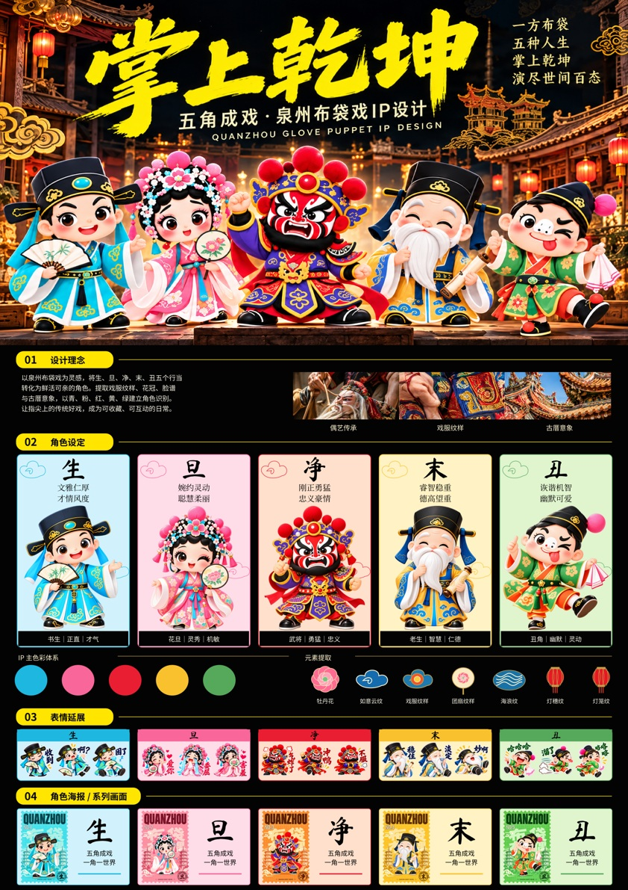
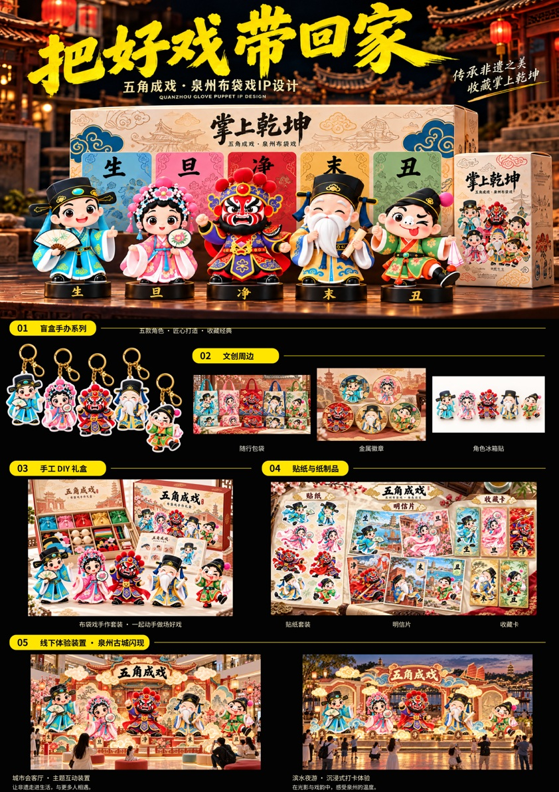

# 三张 A3 展板 · 可编辑 PSD

对应「模板重排版」的三张成品，保持 3508 × 4961 px / 300 dpi / RGB。

## 独立下载

- [01 掌上乾坤 · PSD](./01-A3-editable.psd)（81.6 MiB）
- [02 好戏入日常 · PSD](./02-A3-editable.psd)（70.9 MiB）
- [03 把好戏带回家 · PSD](./03-A3-editable.psd)（74.5 MiB）
- [文字编辑字体包](./fonts-for-editing.zip)

## 可以编辑什么

| 文件 | 独立图层（不含文件夹） | 原生文字层 | 内嵌图片智能对象 |
| --- | ---: | ---: | ---: |
| 01 掌上乾坤 | 154 | 64 | 27 |
| 02 好戏入日常 | 86 | 35 | 17 |
| 03 把好戏带回家 | 44 | 22 | 9 |

图片以智能对象内嵌，不依赖外部图片路径。双击图层缩略图可编辑内容；右键「替换内容」可更换图片。正文、角色介绍、栏目标题与标签为原生文字图层，使用文字工具修改。底板、色块、线条及装饰按元素拆成独立像素层，可单独移动、隐藏、调色或重绘。每张按内容分组，并用中文命名图层。

顶部大幅主视觉中的书法大标题、人物和场景，原本已合成在同一张图片中，因此保留为一个整体智能对象；样机照片中印在物品上的文字、角色和纹样也属于该照片，未伪称为可独立编辑的文字或 3D 模型。

## 打开与编辑

1. 下载并解压字体包，安装四款开放字体，再打开 PSD。
2. 在 Photoshop 中展开需要修改的图层组。黄色标签为文字层，蓝色标签为图片智能对象，灰色标签为图形装饰。
3. 若 Photoshop 提示更新文字层，安装字体后选择「更新」，即可使用本机字体重新排字。建议修改后另存一份。

已用两套独立 PSD 读取器校验图层类型、内嵌图片内容、画布尺寸及 300 dpi 元数据，并从图层重新合成画面比对。没有在 Adobe Photoshop 桌面端实际打开测试。结构及图像校验记录见 verification.json。

## 预览

